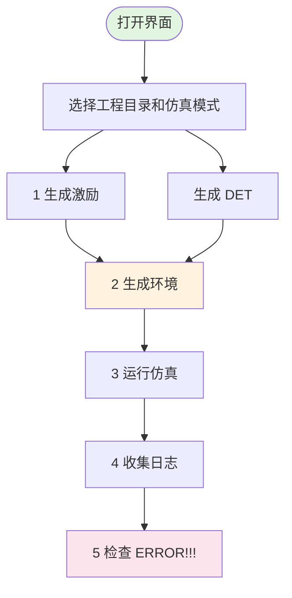
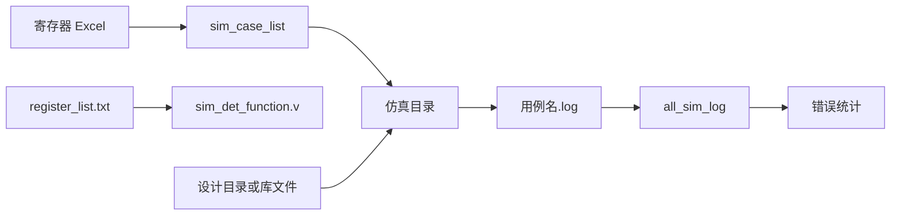

# MIPI RFFE 仿真使用说明

用寄存器 Excel 生成 MIPI RFFE 激励，再按所选模式生成仿真目录、运行仿真，并收集、检查日志。

图形界面在 `design_mipi_ver`。用例、脚本和日志在同级目录 `python_sim_env`。仿真目录生成在它们的上一级。

## 目录关系

```text
python_develop/
├── design_mipi_ver/          界面、激励生成
│   ├── mipi_gui.py
│   ├── gen_sim_case.py
│   └── sim_flow.py
├── python_sim_env/           工程目录，界面默认打开这里
│   ├── sim_case_list/        生成的激励
│   ├── sim_top/              sim_config.v、rffe_base.v
│   ├── register_list.txt     DET 位定义
│   ├── sim_det_function.v    生成 DET 后出现
│   └── all_sim_log/          收集后的日志
├── sim/                      前仿真
├── sim_dc/                   DC 后仿真
├── sim_post/                 后仿真
├── sim_post_max/             后仿真 max
└── sim_post_min/             后仿真 min
```

每个用例目录里有 `sim_top/tb_mipi_master.v`、`makefile` 和 `filelist/filelist.f`。

## 使用流程





## 环境准备

- Python 3.11，并已安装 `pandas`、`xlrd`。使用系统 Python：`C:\Program Files\Python311\python.exe`。
- 不要使用仓库里的 `venv`，它指向的 Python 路径已经不存在。
- 仿真在 Linux 上运行，需要 `make` 和 VCS。有 `gnome-terminal` 时，每个用例单独开一个终端。
- 工程目录名保持 `python_sim_env`。生成出的链接按这个名字指回 `sim_top` 和 `sim_case_list`。

## 启动界面

在 `design_mipi_ver` 下执行：

```text
python mipi_gui.py
```

界面打开后，工程目录默认是 `C:\Users\Dong Tao\Desktop\python_develop\python_sim_env`。换工程时点「选择」。目录还不存在时，把路径填进工程目录，点「创建」。

## 按顺序操作

### 1. 选择仿真模式

五种模式：

| 模式 | 设计路径 | 仿真命令 | `make all` 的编译定义 |
|---|---|---|---|
| `sim` | 含 `mipi*.v` 的目录 | `make all` | `+define+PRE_SIM` |
| `sim_dc` | 库文件 | `make all` | `+define+POST_SIM` |
| `sim_post` | 库文件 | `make all` | `+define+POST_SIM` |
| `sim_post_max` | 库文件 | `make all_max` | 使用 `VCS_MAX`，该命令不含这个定义 |
| `sim_post_min` | 库文件 | `make all_min` | 使用 `VCS_MIN`，该命令不含这个定义 |

`sim` 点「目录」。其余模式点「文件」，选择库文件或网表。

filelist 里的 RTL 路径仍写成 `../../src/slave/<文件名>`，再加上对应模式的网表路径。选择设计路径是为了取得文件名，不会把所选目录的真实相对路径写进 filelist。

### 2. 生成激励

选择寄存器 Excel，点「1 生成激励」。

激励写到工程目录的 `sim_case_list/*.v`。下方日志会列出文件名和数量。

### 3. 生成 DET

点「生成 DET」。程序读取工程目录里的 `register_list.txt`，写出同目录的 `sim_det_function.v`。

`register_list.txt` 第一行是 `ext_command:YES` 或 `NO`。后面每行是地址、支持检测的位、不支持检测的位。`YES` 时会同时生成标准写和扩展写两段检查。

这个文件留在 `python_sim_env`，生成环境时不会把它链进用例目录。

### 4. 生成环境

确认设计路径后，点「2 生成环境」。

点「生成连接」时，从设计路径里的 `mipi_core.v` 读取端口，改写工程目录 `sim_top/rffe_base.v` 的 `mipi_slave` 连接。`rffe_base.v` 里的任务库保持不变。点「仿真配置」可以改 `sim_top/sim_config.v` 里的 USID、厂家号和产品号，保存后写入该文件。

> 这一步会清空上一级目录中当前模式的全部内容，例如选择 `sim` 会清空 `python_develop\sim`。确认框点确定后才会执行。

生成结果：

- 每个 `sim_*.v` 对应一个用例目录。
- 若存在 `all_sim_file.v`，额外生成 `all_sim_file`，里面包含全部用例。
- `sim` 的 makefile 使用 `+define+PRE_SIM`，其他模式的 `make all` 使用 `+define+POST_SIM`。

Linux 上，`sim_config.v`、`rffe_base.v` 和用例激励以符号链接放进用例。当前这台 Windows 没有创建符号链接的权限，这三处会改成复制文件。

### 5. 运行仿真

点「3 运行仿真」。请在 Linux 上执行。Windows 上没有 `make` 时会提示失败。

### 6. 收集日志

仿真结束后，点「4 收集日志」。

程序到当前模式目录中查找 `<用例名>/<用例名>.log`，收进 `python_sim_env/all_sim_log`。没有同名 log 的用例会记为 `no file`。再次收集会先清空 `all_sim_log`。

### 7. 检查日志

点「5 检查日志」。只统计日志中的 `ERROR!!!`。有错误的日志名可以点击，打开该用例的仿真目录。

结果包括：

- `VER_PROJECT`：工程目录里最后一个 `.xls` 或 `.xlsx` 的文件名，取第一个 `_` 之前的部分。例如 `FX5790_reg.xls` 得到 `FX5790`。
- `VER_AUTHOR`：`DongTao`。
- `VER_DATE`：检查时间。
- `ALL_ERR_CNT`：全部日志中的 `ERROR!!!` 行数。

## 命令行

界面和下面的命令做同一件事。命令在 `python_sim_env` 目录执行。

```text
python ..\design_mipi_ver\gen_sim_case.py FX5790.xls
python gen_sim_det.py
bash gen_sim_env.sh sim ..\src\slave
bash run_sim.sh sim
bash get_sim_log.sh sim
bash check_log.sh
```

把 `sim` 换成当前模式。后仿真把设计目录换成库文件路径。

## Linux 程序包

CentOS 7 和 Rocky Linux 8 的打包步骤、依赖版本和 GitHub Actions 触发方式见 [Linux 打包说明](docs/guides/100-2026-11-25-Linux打包.md)。

## 常见问题

- 激励目录是空的：先在界面里把工程目录指到 `python_sim_env`，再生成激励。脚本的输出位置取决于当前目录。
- 生成环境后用例里看不到新的 DET：`sim_det_function.v` 不进入用例目录，需要自行加入仿真。
- 日志检查的项目名是空的：把对应 Excel 放在 `python_sim_env` 目录下，文件名用 `_` 分隔项目名。
- 收集日志提示仿真目录不存在：先生成环境并完成仿真，再按同一个模式收集。
